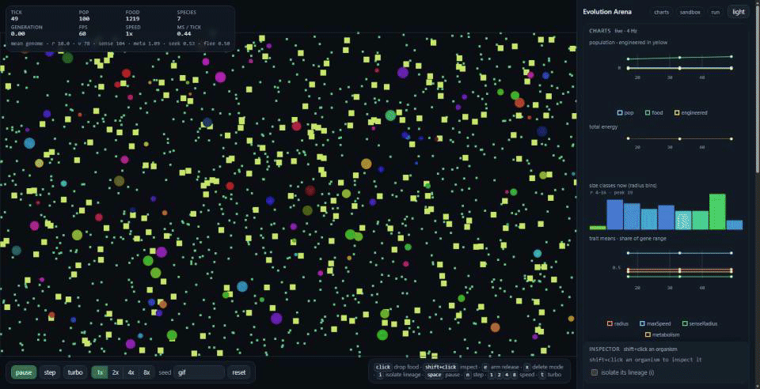

# Evolution Arena

Little creatures live in a box. They hunt, eat, grow, split in two, and get eaten by whatever is
bigger than them. Their young come out a little different from their parents, so after an hour of
running the population has changed shape on its own: a small form and a large form sharing the arena,
with nothing in between. Nobody steers it, and nothing in it is scripted.



Under that sits a live 2D world with heritable traits, energy budgets, size-based predation, two
classes of food, and charts that fill in while it runs. The camera shows the whole arena from above:
no follow cam, no avatar, no score. Turbo runs about 15 simulated seconds per wall second, so **an
hour of world costs about four minutes** of yours.

## Quickstart

```sh
git clone https://github.com/AgentDudu/evolution-arena-v2.git
cd evolution-arena-v2
pnpm install
pnpm dev
```

## What is going on in there

- **Nothing is scripted.** Every organism has a heritable genome - radius, max speed, sense radius,
  metabolism, reproduction threshold, seek-food, flee, wander, hue (nine genes, radius spanning 4 to 16
  world units) - and passes a mutated copy of it on when it splits. Body colour comes from the hue gene,
  body lightness from energy reserves, so starvation is visible without a graph.
- **Energy is the only currency.** Moving, sensing and staying alive all cost. Eat or die; there is no
  other income.
- **Two classes of food, which is the whole trick.** Small green particles (radius 3, 25 energy) that
  anything can handle, and large yellow-green ones (radius 8, 60 energy) that only an organism of
  radius ~14.5 or more can swallow. The giant morph therefore owns a resource the dwarf morph cannot
  touch, so it recovers when rare instead of being bred out - right up against the radius ceiling of 16.
  Particles under an organism's handling size are still eaten, but worth only 15% - a giant can barely
  live on crumbs.
- **Predation is by size ratio,** with a refuge radius below which a small organism simply cannot be
  eaten, so the dwarf niche is not a death sentence either.

## Controls and Features

- `LeftClick` the arena to drop food on where your cursor is.
- `Shift+click` inspect organism
- `i` isolate an inspected organism's lineage
- `space` pause, 
- `n` one tick, 
- `s` speed 1x -> 2x -> 4x -> 8x, 
- `t` turbo (ticks until the frame budget
  is spent, still drawing).
- `e` change mode to drop 1-50 copies of genome 
- `x` delete mode
- Containts charts, sandbox, sim knobs, run
- Live graphs for population, food, total energy, every trait mean as a share of its gene's range, species
  count, and the radius histogram.
- 8 parameters: food per tick, large-food share, crumb penalty, predation ratio, refuge
  radius, mutation rate, predation on/off, reseed when empty.
- Three events: **food bloom** scatters particles up to the food cap, **catastrophe** kills on one rng coin
  flip per organism where they stand, **mutation burst** runs the ordinary fission mutation step over
  every genome once. This will push a genome without waiting for generations.
- Dark and light theme
- Save, share, and replay your world progression. 

## License

MIT - see [LICENSE](LICENSE). No server, no accounts, no build artifacts committed: the sim, the charts and the
saves all live in one browser tab (`localStorage`), and `node scripts/headless.ts` runs the same world
with no browser at all.
